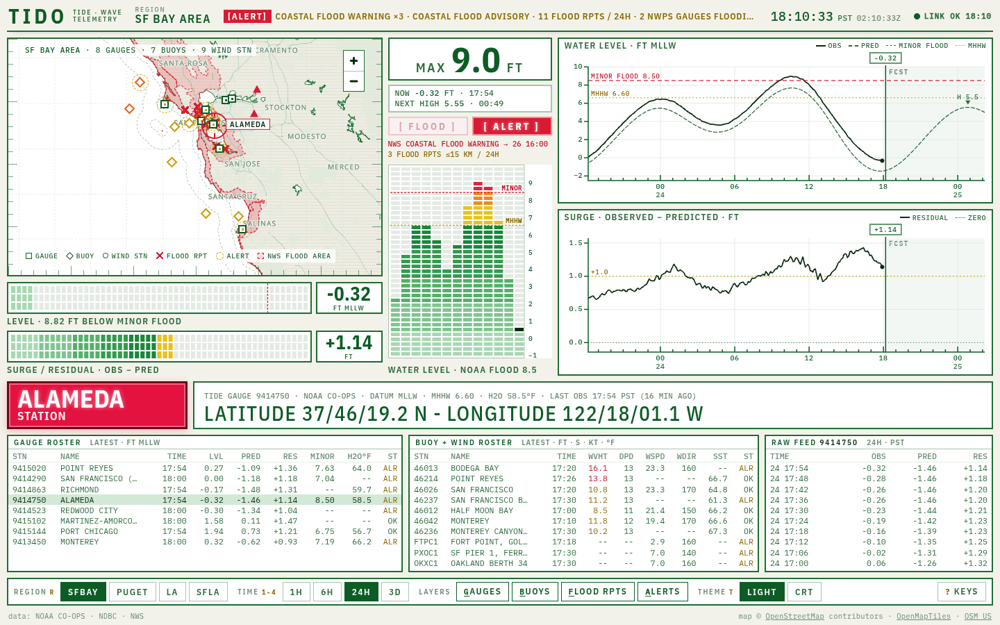
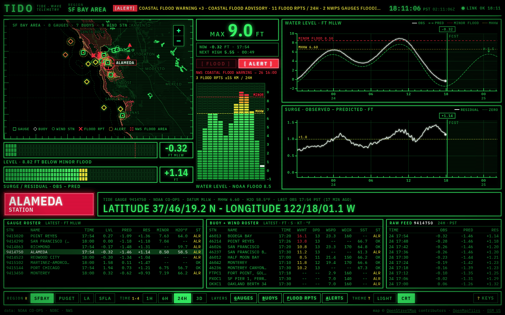
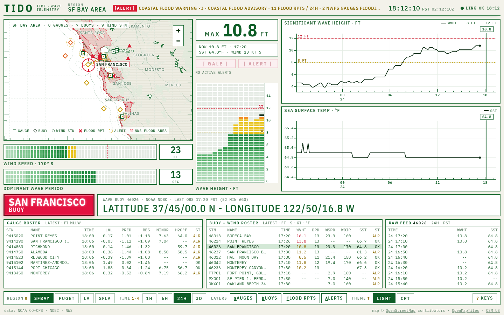
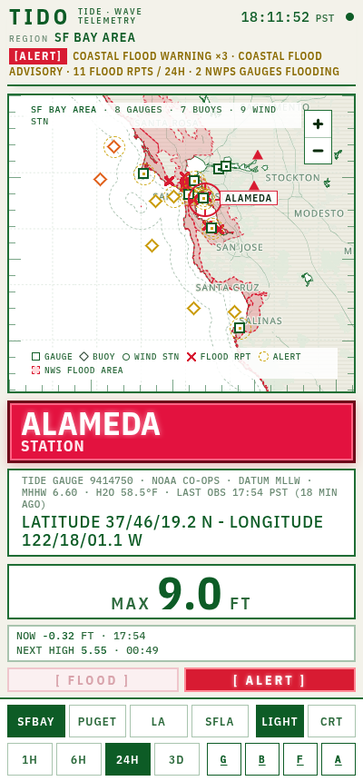

# TIDO

**Tide · wave telemetry on a retro instrument screen.**



TIDO is a single static web page that shows live NOAA tide gauges, wave buoys and shore wind sensors the way an old
telemetry console would: a region map with station markers, segmented LED meters, observed-vs-predicted water level
and storm-surge graphs, flood and alert lamps, station rosters and a raw data feed. It covers four regions (SF Bay
Area, Puget Sound, Los Angeles / SoCal and Miami / South Florida), looks back 1 hour to 3 days, and comes in a paper
LIGHT theme and a black-and-green CRT theme. There is no build step and no framework; the page reads ready-made
JSON snapshots from the [Coast Watch](https://github.com/nviiiivn/jetski/tree/tides-alola) data server, which also
serves the page itself.

**Live:** <https://tido.alola.lol>

| CRT theme | Buoy selected |
| --- | --- |
|  |  |

<p align="center">
  
</p>

## Features

- **Region map** (MapLibre GL, OpenStreetMap vector tiles in a two-colour style per theme) with tide gauges, wave
  buoys, shore wind stations, flood reports, flooding river/tide gauges and NWS coastal flood alert areas. Gauges,
  buoys, flood reports and alert areas can each be switched off.
- **Tide gauges:** biggest water level in the time window, the latest reading and the next predicted high tide;
  a segmented LED history meter that turns yellow above MHHW and red above the minor flood level; bars for level vs.
  the flood threshold and for surge (observed minus predicted); graphs of observed vs. predicted water level with
  upcoming highs and lows, and of the surge residual.
- **Buoys:** wave height history meter (yellow from 8 ft, red from 12 ft), wind speed and dominant wave period bars,
  significant wave height and sea surface temperature graphs. Wind-only stations show wind speed and direction.
- **Lamps and reasons:** FLOOD (gauge at or above its NOAA/NWS flood level) or GALE (wind 34 kt and up), and ALERT
  when an NWS coastal flood product covers the station within 10 km, a flood report came in within 15 km in the last
  24 h, or a nearby NWPS gauge is flooding. The line under the lamps says which.
- **Header:** region, an alert summary for the whole region, local and UTC clocks, and the data link state
  (LINK OK / PARTIAL / LOST, with the failing source in the tooltip).
- **Rosters:** every gauge and buoy in the region with its latest values and state; click a row to select it.
  The raw feed lists every reading of the selected station in the time window.
- **Timeline:** 1H, 6H, 24H or 3D for every graph, meter and report.
- **Themes:** LIGHT (default) and CRT with scanlines. The choice is saved in the browser.
- **Links you can share:** the address keeps the region, station and time window, e.g.
  `https://tido.alola.lol/?region=sfbay&station=46026&t=24h`. `?station=` on its own is enough; the page finds the
  region. Older `#/sfbay/46026/24h` links still open.
- Refreshes every 5 minutes, and again when you come back to the tab. Remembers the last station you picked in each
  region and which map layers you had on.
- Keyboard first: every control is reachable by key (below); markers and roster rows are real buttons; changes are
  announced to screen readers.

## Keyboard

| Key | Action |
| --- | --- |
| `J` / `K` or `→` / `←` | Next / previous station |
| `1` `2` `3` `4` | Timeline 1H · 6H · 24H · 3D |
| `R` / `Shift+R` | Next / previous region |
| `G` `B` `F` `A` | Toggle gauges · buoys · flood reports · NWS alerts |
| `T` | Theme LIGHT / CRT |
| `Tab` | Move through map markers, rosters and menu |
| `?` / `Esc` | Show / hide the key list (Esc also closes a map popup) |

## How it fits together

```
browser ── GET /                       ─┐
        ── GET /snapshot/tides?region=  │   Coast Watch server (Node, server/serve.mjs)
        ── GET /snapshot/buoys?region=  ├─▶   /snapshot/*  → builds + caches JSON from NOAA / NWS / IEM
        ── GET /snapshot/weather?...    │   everything else → TIDO's files (this repo)
        ── GET /snapshot/floods?...    ─┘
        ── map tiles + fonts ──────────────▶ tiles.openstreetmap.us
```

TIDO has no server code of its own. `app.js` fetches `/snapshot/{tides,buoys,weather,floods}?region=…` from the
same origin it was loaded from, so it must be served by the Coast Watch data server (or by a proxy in front of it
on the same host name). Coast Watch's `server/serve.mjs` serves TIDO's folder in two cases:

- the request's `Host` header starts with `tido.` (for example `tido.example.com`): the whole host is TIDO;
- the path starts with `/__tido/` (for example `http://localhost:8970/__tido/`), on any host, for local use.

Any other host name and path gets Coast Watch's own dashboard. The server finds TIDO's folder through the
`TIDO_DIR` environment variable; without it, it uses a folder named `tido` next to the Coast Watch checkout.

## Run it on your own server

You need **Node.js 20 or newer**, **git**, and outbound HTTPS from the server to the NOAA, NWS and Iowa Mesonet
APIs (no API keys are needed). Viewers' browsers load map tiles directly from `tiles.openstreetmap.us`.

### 1. Clone both repositories side by side

```sh
mkdir tide-station && cd tide-station
git clone --branch tides-alola https://github.com/nviiiivn/jetski.git coast-watch
git clone https://github.com/nviiiivn/tido.git
```

You end up with:

```
tide-station/
├── coast-watch/   data server (serves TIDO too)
└── tido/          this repo
```

### 2. Install, build and start Coast Watch

```sh
cd coast-watch
npm install && npm run build && npm start
```

`npm start` prints `tides: http://127.0.0.1:8970`. Recent npm versions may warn that esbuild's install script was
skipped (`allow-scripts`); the build works anyway.

### 3. Open TIDO

Go to <http://localhost:8970/__tido/> (keep the trailing slash). The link light in the top right says **SYNC…**
while the server collects the first snapshots for the region, which can take several seconds, then **LINK OK**.
Snapshots are kept in memory and in `coast-watch/.data/`, so later loads are fast and survive restarts.

### Settings

All optional, set as environment variables for `npm start`:

| Variable | Default | What it does |
| --- | --- | --- |
| `PORT` | `8970` | Port to listen on |
| `HOST` | `127.0.0.1` | Address to listen on. Keep the default behind a reverse proxy; use `0.0.0.0` to reach it from other machines directly |
| `TIDO_DIR` | `../tido` (next to Coast Watch) | Folder with TIDO's `index.html`. Use an absolute path |
| `UPSTREAM_TIMEOUT_MS` | `15000` | Timeout in milliseconds for each request to NOAA / NWS / IEM |

Example with TIDO somewhere else:

```sh
PORT=8970 TIDO_DIR=/srv/tido npm start
```

The National Weather Service asks every API client to identify itself in its `User-Agent`. Coast Watch sends a fixed
one, set as `NWS_USER_AGENT` in `coast-watch/server/serve.mjs`; change it to your own site name and a contact address
when you run your own copy.

### Put it on a host name

Point a DNS name that starts with `tido.` at your server and proxy the whole host to Coast Watch. The proxy must pass
the original `Host` header through, because that is how the server tells TIDO's host apart from its own.

**Caddy** passes `Host` through unchanged by default and gets the TLS certificate on its own:

```caddyfile
tido.example.com {
	reverse_proxy 127.0.0.1:8970
}
```

**nginx** replaces `Host` with the upstream address unless told otherwise, so set it explicitly:

```nginx
server {
    listen 443 ssl;
    http2 on;
    server_name tido.example.com;

    ssl_certificate     /etc/letsencrypt/live/tido.example.com/fullchain.pem;
    ssl_certificate_key /etc/letsencrypt/live/tido.example.com/privkey.pem;

    location / {
        proxy_pass http://127.0.0.1:8970;
        proxy_set_header Host $host;
        proxy_set_header X-Forwarded-For $proxy_add_x_forwarded_for;
        proxy_set_header X-Forwarded-Proto $scheme;
    }
}

server {
    listen 80;
    server_name tido.example.com;
    return 301 https://$host$request_uri;
}
```

(`http2 on;` needs nginx 1.25.1 or newer; on older versions drop that line and write `listen 443 ssl http2;`.)

If the host name cannot start with `tido.`, proxy it anyway and send visitors to `/__tido/`.

### Run it as a service (systemd)

Create a user for it, put the checkout under `/opt/tide-station`, and make the snapshot folder writable:

```sh
sudo useradd --system --home /opt/tide-station --shell /usr/sbin/nologin tido
sudo mkdir -p /opt/tide-station/coast-watch/.data
sudo chown -R tido:tido /opt/tide-station
```

`/etc/systemd/system/tido.service`:

```ini
[Unit]
Description=Coast Watch data server with TIDO
After=network-online.target
Wants=network-online.target

[Service]
Type=simple
User=tido
Group=tido
WorkingDirectory=/opt/tide-station/coast-watch
Environment=PORT=8970
Environment=HOST=127.0.0.1
Environment=TIDO_DIR=/opt/tide-station/tido
# use the path that `command -v node` prints
ExecStart=/usr/bin/node server/serve.mjs
Restart=on-failure
RestartSec=5

NoNewPrivileges=true
PrivateTmp=true
ProtectSystem=strict
ProtectHome=true
ReadWritePaths=/opt/tide-station/coast-watch/.data

[Install]
WantedBy=multi-user.target
```

```sh
sudo systemctl daemon-reload
sudo systemctl enable --now tido
journalctl -u tido -f
```

### Updating

```sh
cd tide-station/tido && git pull
cd ../coast-watch && git pull && npm install && npm run build
sudo systemctl restart tido     # or stop and re-run npm start
```

TIDO's files are read from disk on every request, so a `git pull` in `tido/` is live on the next page load.

### Troubleshooting

- **LINK LOST or LINK PARTIAL.** The server could not reach some upstream APIs. Hover the link light: its tooltip
  names the sources that failed. Check the server log too (`journalctl -u tido` or the terminal running `npm start`).
- **You get the Coast Watch dashboard instead of TIDO.** The `Host` the server sees does not start with `tido.`.
  Check that your proxy passes `Host` through (nginx: `proxy_set_header Host $host;`), or use `/__tido/`.
- **TIDO loads but shows no data at a custom path.** TIDO asks for `/snapshot/...` at the root of its own origin.
  Serve it from a host name that proxies everything to Coast Watch, as above.
- **Blank map, data fine.** The basemap comes from `tiles.openstreetmap.us`; the viewer's browser needs to reach it.

## Files

```
index.html      page layout, inline theme pick before first paint
app.js          data loading, state, map, panels, keyboard
gfx.js          SVG instruments: line graphs and segmented LED meters
mapstyle.js     MapLibre style and colour palettes for LIGHT and CRT
regions.js      region framing, bounds and time zones
style.css       both themes, layout for desktop, tablet and phone
vendor/         MapLibre GL JS 4.7.1 and IBM Plex fonts, with their licences
docs/           screenshots
```

Browser storage keys: `tido.theme`, `tido.station`, `tido.layers`. When no theme has been picked, TIDO follows an
`alola-theme` cookie if one is present (set by the alola.lol sites) and is LIGHT otherwise.

## Data sources and credits

All station data is fetched and cached by the Coast Watch data server:

- [NOAA CO-OPS Tides & Currents](https://tidesandcurrents.noaa.gov/): observed and predicted water levels, high/low
  tide predictions, water temperature, MHHW and flood thresholds (datum MLLW).
- [NOAA National Data Buoy Center](https://www.ndbc.noaa.gov/): wave height, dominant period, wind and sea surface
  temperature from buoys and shore stations.
- [National Weather Service API](https://api.weather.gov/) (api.weather.gov): coastal flood and marine alerts and their
  areas.
- [Iowa Environmental Mesonet](https://mesonet.agron.iastate.edu/) Local Storm Reports: NWS flood reports from
  spotters, officials and the public.
- [NOAA National Water Prediction Service](https://water.noaa.gov/): gauges at action stage or flooding.
- [DataSF](https://datasf.org/) San Francisco 311 sewer-flooding requests (SF Bay region only).

Map and page:

- Map data © [OpenStreetMap](https://www.openstreetmap.org/copyright) contributors, in the
  [OpenMapTiles](https://openmaptiles.org/) schema, served by the [OSM US Tileservice](https://tiles.openstreetmap.us/).
- [MapLibre GL JS](https://maplibre.org/) 4.7.1, BSD 3-Clause (`vendor/maplibre-LICENSE.txt`).
- [IBM Plex](https://github.com/IBM/plex) Sans Condensed and Mono, SIL Open Font License 1.1
  (`vendor/fonts/OFL-IBM-Plex.txt`).
- The data server is [Coast Watch](https://github.com/nviiiivn/jetski/tree/tides-alola), a self-hosted fork of
  [Bay Coast Watch](https://github.com/rishabhbajpailab/jetski).

TIDO is not affiliated with NOAA or the National Weather Service.

## License

[MIT](LICENSE) © 2026 nviiiivn. The bundled MapLibre GL JS and IBM Plex files keep their own licences (see
[LICENSE](LICENSE) and `vendor/`).
